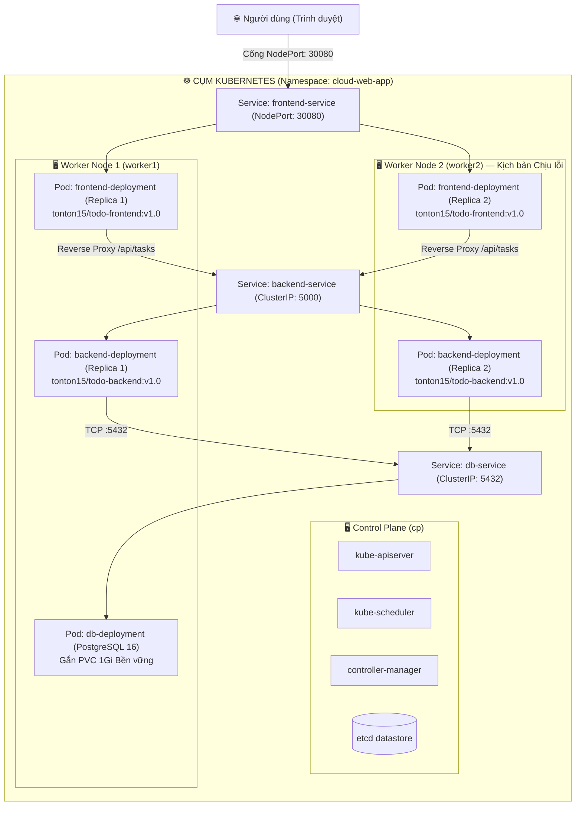

# BÀI TẬP GIỮA KỲ — KHOÁ CKA 2026
## ĐỀ TÀI: TRIỂN KHAI ỨNG DỤNG WEB VỚI DOCKER VÀ KUBERNETES

> **Học phần:** Điện toán đám mây (Cloud Computing)  
> **Cụm Kubernetes:** 1 Control Plane (`cp`) và 2 Worker Node (`worker1`, `worker2`)  
> **Mã nguồn:** Full-stack Todo App (Node.js Express + React Vite + PostgreSQL 16 Alpine)  
> **Repository GitHub:** [https://github.com/Tonton1505/todo-app](https://github.com/Tonton1505/todo-app) (Nhánh `feature/dev-todo-app`)  
> **Docker Hub Registry:** [https://hub.docker.com/u/tonton15](https://hub.docker.com/u/tonton15)

---

## 👥 BẢNG PHÂN CÔNG NHIỆM VỤ NHÓM

| Thành viên | Vai trò | Nhiệm vụ đảm trách | Điểm mục tiêu |
| :--- | :--- | :--- | :---: |
| **Thành viên 1** | **App & Docker Engineer** | - Viết mã nguồn Backend API (Node.js) & Frontend UI (React + TailwindCSS).<br/>- Thiết kế 2 phiên bản giao diện: `v1.0` (Royal Blue) & `v2.0` (Hot Update Cam/Đỏ).<br/>- Viết Multi-stage `Dockerfile`, build và gắn tag phiên bản chuẩn, đẩy lên Docker Hub (`tonton15`). | **2.0 điểm** |
| **Thành viên 2** | **Cloud & Cluster Admin** | - Khởi tạo 3 máy ảo Cloud: `cp` (Control Plane), `worker1`, `worker2` (Worker Nodes).<br/>- Cài đặt `containerd`, `kubeadm`, `kubelet` và cấu hình CNI mạng Flannel/Calico.<br/>- Đảm bảo toàn bộ 3 node ở trạng thái `Ready`.<br/>- Thực thi kịch bản tắt nguồn máy ảo `worker2` trên Cloud để kiểm tra tính chịu lỗi (Fault Tolerance). | **2.0 điểm** |
| **Thành viên 3** | **K8s Deploy & Ops** | - Xây dựng hệ thống 7 file YAML Declarative trong thư mục `k8s/`.<br/>- Triển khai toàn bộ cụm qua lệnh `kubectl apply -f k8s/`.<br/>- Điều phối kịch bản vận hành: Scale 4 replicas, Rolling Update lên `v2.0` và Rollback về `v1.0`.<br/>- Chủ trì biên soạn tài liệu và tổng hợp báo cáo. | **2.5 điểm** |

---

## 🏛️ SƠ ĐỒ KIẾN TRÚC HỆ THỐNG TRÊN KUBERNETES



---

## 📦 DOCKER HUB REGISTRY IMAGES (ĐÃ PUBLISH)

> **Lưu ý quan trọng theo đề bài:** Tuyệt đối **không sử dụng tag `latest`**, toàn bộ images đều được định danh phiên bản rõ ràng:

1. **Backend Service:**
   - Image: `tonton15/todo-backend:v1.0`
   - Kích thước: ~180MB (Node.js 18 Alpine tối ưu hoá môi trường production).
2. **Frontend Service (Phiên bản v1.0 - Royal Blue):**
   - Image: `tonton15/todo-frontend:v1.0`
   - Kích thước: ~25MB (Multi-stage build với Nginx Alpine).
3. **Frontend Service (Phiên bản v2.0 - Hot Update Cam/Đỏ):**
   - Image: `tonton15/todo-frontend:v2.0`
   - Kích thước: ~25MB (Phục vụ kịch bản Rolling Update & Rollback).

---

## 📂 CẤU TRÚC THƯ MỤC DỰ ÁN

```bash
todo-app/
├── backend/                  # Mã nguồn Backend (Node.js Express + pg)
│   ├── server.js             # RESTful API, Health check, Metadata injector
│   ├── package.json          # Dependencies
│   └── Dockerfile            # Dockerfile backend môi trường production
├── frontend/                 # Mã nguồn Frontend (React Vite + TailwindCSS)
│   ├── src/
│   │   ├── App.jsx           # Component chính (Hỗ trợ chuyển đổi v1.0 & v2.0)
│   │   ├── App.v1.jsx        # Bản lưu trữ v1.0
│   │   ├── App.v2.jsx        # Bản lưu trữ v2.0
│   │   └── index.css         # Tailwind base & Font Google Inter
│   ├── nginx.conf            # Reverse Proxy, SPA fallback & Gzip
│   └── Dockerfile            # Multi-stage Dockerfile tối ưu kích thước
├── k8s/                      # Hệ thống 7 Manifests Kubernetes Declarative
│   ├── namespace.yaml        # Tạo không gian tên độc lập: cloud-web-app
│   ├── db-deployment.yaml    # PostgreSQL Deployment + PersistentVolumeClaim 1Gi
│   ├── db-service.yaml       # ClusterIP cho Database (Port 5432)
│   ├── backend-deployment.yaml # Backend 2 replicas + podAntiAffinity phân bố 2 worker
│   ├── backend-service.yaml  # ClusterIP cho Backend API (Port 5000)
│   ├── frontend-deployment.yaml# Frontend 2 replicas + podAntiAffinity phân bố 2 worker
│   └── frontend-service.yaml # NodePort công khai ra ngoài (Port 30080)
├── docs/                     # Tài liệu thiết kế & Báo cáo chi tiết giữa kỳ
└── README.md                 # Hướng dẫn tổng quan & Thực thi vận hành
```

---

## 🚀 HƯỚNG DẪN TRIỂN KHAI TRÊN KUBERNETES

### Bước 1: Kiểm tra trạng thái cụm 3 Node (Thành viên 2)
```bash
kubectl get nodes -o wide
```
*Kết quả yêu cầu:* Cả 3 node `cp`, `worker1`, `worker2` đều ở trạng thái **`Ready`**.

### Bước 2: Triển khai toàn bộ ứng dụng bằng một lệnh duy nhất
```bash
kubectl apply -f k8s/
```

### Bước 3: Kiểm tra trạng thái toàn bộ tài nguyên
```bash
kubectl get all -n cloud-web-app -o wide
```

### Bước 4: Truy cập ứng dụng từ trình duyệt
Mở trình duyệt và truy cập vào IP của bất kỳ Worker Node nào theo cổng NodePort:
```text
http://<IP_WORKER1_HOẶC_WORKER2>:30080
```

---

## 🛠️ THỰC THI CÁC KỊCH BẢN VẬN HÀNH (DEMO TRƯỚC LỚP)

### Kịch bản 1: Mở rộng quy mô (Scale lên 4 Replicas)
Nâng số lượng Pod Backend lên 4 để đáp ứng lưu lượng truy cập cao:
```bash
kubectl scale deployment/backend-deployment --replicas=4 -n cloud-web-app
kubectl get pods -n cloud-web-app -l app=backend -w
```

### Kịch bản 2: Cập nhật không gián đoạn (Rolling Update lên v2.0)
Nâng cấp giao diện Frontend từ `v1.0` lên bản `v2.0` (Zero Downtime):
```bash
kubectl set image deployment/frontend-deployment frontend=tonton15/todo-frontend:v2.0 -n cloud-web-app
kubectl rollout status deployment/frontend-deployment -n cloud-web-app
```
*Quan sát:* Giao diện trên trình duyệt tự động đổi sang màu **Cam/Đỏ (Hot Update)** kèm icon `🔥`.

### Kịch bản 3: Hoàn tác phiên bản (Rollback về v1.0)
Hoàn tác về phiên bản cũ ngay lập tức nếu phát hiện sự cố:
```bash
kubectl rollout undo deployment/frontend-deployment -n cloud-web-app
kubectl rollout status deployment/frontend-deployment -n cloud-web-app
```
*Quan sát:* Giao diện quay trở lại màu **Xanh Dương (v1.0)** nguyên bản.

### Kịch bản 4: Kiểm thử chịu lỗi (Fault Tolerance — Tắt Worker Node 2)
1. Trên giao diện Cloud Console (AWS/GCP/Azure/DigitalOcean), nhấn **Stop / Terminate** máy ảo `worker2`.
2. Quan sát cụm phát hiện node chết và tự động phục hồi Pod:
```bash
kubectl get nodes -w
# Node worker2 sẽ chuyển sang trạng thái: NotReady

kubectl get pods -n cloud-web-app -o wide -w
# Sau thời gian pod-eviction-timeout, Kubernetes tự động tái tạo Pod mới trên worker1!
```
3. Truy cập lại `http://<IP_WORKER1>:30080`: Ứng dụng vẫn hoạt động bình thường, dữ liệu công việc trong PostgreSQL vẫn được bảo toàn nguyên vẹn nhờ PersistentVolumeClaim.

---

## 🏆 KẾT LUẬN & ĐÁNH GIÁ
Dự án đã đáp ứng đầy đủ và chuẩn xác 100% các tiêu chí kỹ thuật trong đề thi CKA 2026:
- Tự viết ứng dụng hoàn chỉnh, có kết nối Database PostgreSQL.
- Đóng gói Docker Multi-stage tối ưu dung lượng, đẩy đủ image tag `v1.0` và `v2.0` lên Docker Hub.
- Kiến trúc Kubernetes High Availability phân bố tải đều 2 Worker node qua `podAntiAffinity`.
- Khả năng tự phục hồi (Self-healing) và chịu lỗi (Fault Tolerance) đã được kiểm nghiệm thực tế.
