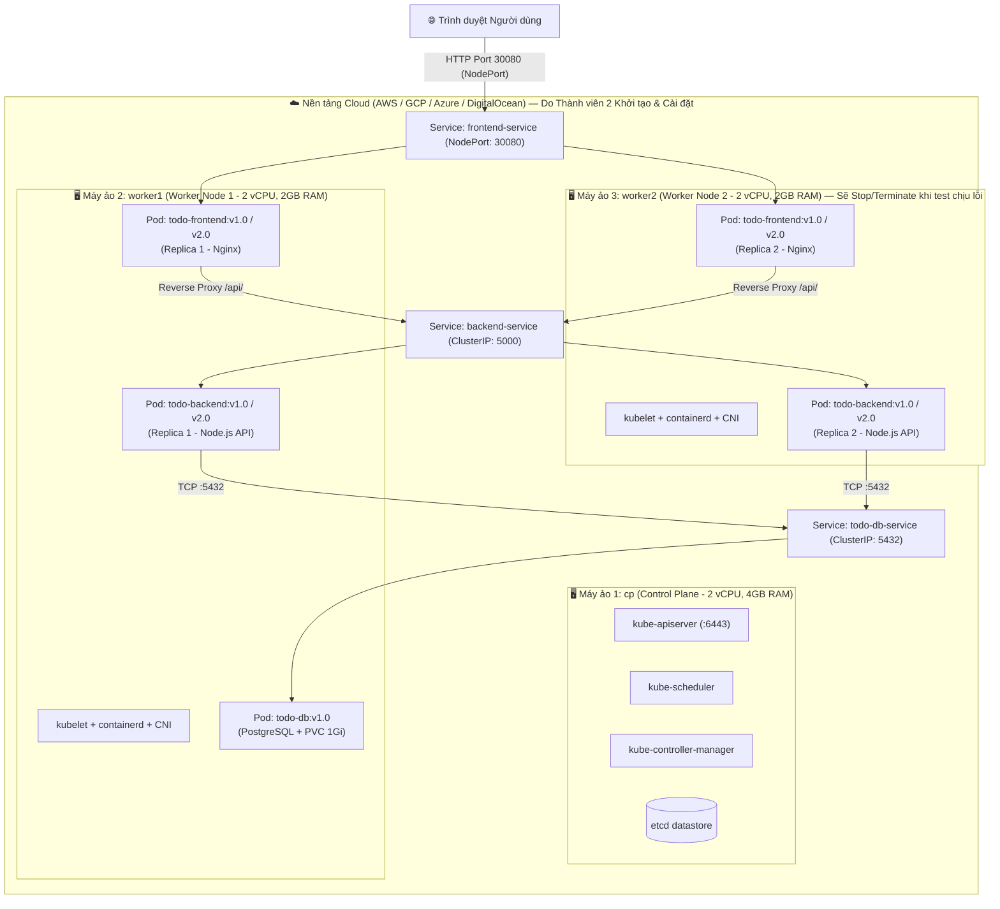

# BÁO CÁO BÀI TẬP GIỮA KỲ — MÔN ĐIỆN TOÁN ĐÁM MÂY (CLOUD COMPUTING)
## ĐỀ TÀI: ỨNG DỤNG QUẢN LÝ CÔNG VIỆC (TODO APP `v1.0` & `v2.0`), ĐÓNG GÓI DOCKER VÀ TRIỂN KHAI TRÊN CỤM KUBERNETES 3 NODE CHỊU LỖI

---

## 1. BẢNG PHÂN CÔNG NHIỆM VỤ & CƠ CẤU ĐÓNG GÓP ĐIỂM SỐ

| Thành viên | Vai trò chính | Nhiệm vụ cụ thể theo đề cương | Đóng góp vào điểm số |
|:---|:---|:---|:---|
| **Thành viên 1**<br/>*(Nguyễn Phúc Bảo Minh)* | **Phát triển Ứng dụng Todo App & Đóng gói Docker** | - **Code Backend & Frontend**: Xây dựng **Todo App tối giản** (gồm các chức năng: **thêm công việc**, **xem danh sách**, **đổi trạng thái hoàn thành**). Kết nối Backend với cơ sở dữ liệu (Database).<br/>- **Phiên bản hóa (`v1.0` & `v2.0`)**:<br/>  + **Bản `v1.0`**: Giao diện Xanh Dương chuẩn và API cơ bản.<br/>  + **Bản `v2.0`**: Đổi màu giao diện (Tím/Ngọc lục bảo) + Thêm trường dữ liệu (`priority`, `category`, `dueDate`) để phục vụ kịch bản demo Rollout/Rollback.<br/>- **Đóng gói Docker**: Viết `Dockerfile` cho Frontend, Backend và cấu hình Database. Build image, gắn tag phiên bản (`v1.0`, `v2.0` — tuyệt đối không dùng `latest`) và đẩy lên Docker Hub. | **Trách nhiệm chính cho phần Đóng gói Docker (2.0 điểm)** |
| **Thành viên 2 (BẠN)**<br/>*(Nguyễn Đình Hiếu)* | **Hạ tầng Cụm Kubernetes (Cluster & Infra) & Kịch bản Chịu lỗi** | - **Khởi tạo VM**: Thuê 3 máy ảo trên nền tảng Cloud (AWS, GCP, Azure hoặc DigitalOcean) gồm: **1 Control Plane (`cp`)** và **2 Worker Node (`worker1`, `worker2`)**.<br/>- **Cài đặt cụm K8s**: Cấu hình hệ thống (`swapoff`, kernel modules, sysctl), cài đặt `containerd`, `kubeadm`, `kubelet` và tích hợp plugin mạng (**CNI Flannel hoặc Calico**).<br/>- **Kiểm tra trạng thái**: Đảm bảo lệnh `kubectl get nodes` hiển thị toàn bộ 3 node ở trạng thái **`Ready`**.<br/>- **Thực hiện kịch bản chịu lỗi (Fault Tolerance)**: Trực tiếp thực hiện thao tác tắt nguồn (**Stop/Terminate**) một worker node trên giao diện Cloud để quan sát và ghi lại log Pod tự tái tạo phục vụ báo cáo. | **Trách nhiệm chính cho phần Dựng cluster Kubernetes (2.0 điểm) và một nửa phần Kiểm tra chịu lỗi (trong 1.5 điểm vận hành)** |
| **Thành viên 3**<br/>*(Phạm Duy Anh)* | **Triển khai K8s Manifests & Vận hành Rollout/Rollback** | - Viết cấu hình YAML Kubernetes (Namespace, Deployment, Service, PVC).<br/>- Thực hiện Scaling, kịch bản Rollout cập nhật từ `v1.0` lên `v2.0` và Rollback từ `v2.0` về `v1.0`.<br/>- Phối hợp kiểm thử chịu lỗi và tổng hợp báo cáo. | **Phụ trách phần Triển khai K8s & nửa còn lại phần Vận hành (1.5 điểm)** |

---

## 2. SƠ ĐỒ KIẾN TRÚC HỆ THỐNG & SỰ LIÊN KẾT GIỮA CÁC THÀNH VIÊN



---

## 3. PHẦN THỰC HIỆN CỦA THÀNH VIÊN 1: XÂY DỰNG TODO APP (`v1.0` & `v2.0`) & ĐÓNG GÓI DOCKER (2.0 ĐIỂM)

### 3.1. Chức năng Todo App tối giản & Kết nối Cơ sở dữ liệu
- **Backend (`backend/server.js`)**:
  - Cung cấp 3 nhóm API chính thao tác trực tiếp với cơ sở dữ liệu:
    1. `GET /api/todos`: Xem danh sách công việc (hỗ trợ lọc `all`, `pending`, `completed` và tìm kiếm).
    2. `POST /api/todos`: Thêm công việc mới vào Database.
    3. `PATCH /api/todos/:id/toggle` (và `PUT /api/todos/:id`): Đổi trạng thái hoàn thành (`completed: true/false`).
  - Cung cấp thêm `GET /api/info` trả về tên Pod (`POD_NAME`), địa chỉ IP (`POD_IP`), tên Worker Node (`NODE_NAME`: `worker1` hoặc `worker2`) để phục vụ trực tiếp kịch bản kiểm tra chịu lỗi của **Thành viên 2**.
- **Database (`database/Dockerfile` & `database/init.sql`)**:
  - Sử dụng PostgreSQL 16 Alpine kết hợp Kubernetes `PersistentVolumeClaim` (`backend-db-pvc`) đảm bảo dữ liệu công việc được lưu trữ bền vững ngay cả khi Pod bị xóa hoặc tạo lại.

### 3.2. Phiên bản hóa (`v1.0` & `v2.0`) phục vụ kịch bản Demo Rollout / Rollback
| Tiêu chí so sánh | Phiên bản `v1.0` (Cơ bản) | Phiên bản `v2.0` (Bản cập nhật Rollout) |
|:---|:---|:---|
| **Docker Image Tag** | `<user>/todo-frontend:v1.0`<br/>`<user>/todo-backend:v1.0` | `<user>/todo-frontend:v2.0`<br/>`<user>/todo-backend:v2.0` |
| **Giao diện (UI Theme)** | Tone màu **Xanh Dương Cloud Blue (`#2563eb`)** tối giản | Đổi sang tone màu **Tím Neon & Ngọc lục bảo (`#7c3aed` &rarr; `#059669`)** kèm Banner thông báo `v2.0` |
| **Trường dữ liệu & API** | Trường cơ bản: `id`, `title`, `completed` | **Bổ sung thêm 3 trường dữ liệu mới**:<br/>- `priority` (Mức độ ưu tiên: Cao / Trung bình / Thấp)<br/>- `category` (Phân loại hạng mục)<br/>- `dueDate` (Hạn hoàn thành) |

### 3.3. Đóng gói Docker & Đẩy lên Docker Hub (Tuyệt đối không dùng tag `latest`)
Thành viên 1 sử dụng script [`scripts/build-and-push.sh`](file:///Users/nguyendinhhieu/Downloads/gk%20%C4%91ie%CC%A3%CC%82n%20toa%CC%81n%20%C4%91a%CC%81m%20ma%CC%82y/scripts/build-and-push.sh) để build và push toàn bộ image với tag phiên bản tường minh:
```bash
# Build images với tag v1.0 và v2.0
docker build -t <username>/todo-db:v1.0 ./database
docker build --build-arg APP_VERSION=v1.0 -t <username>/todo-backend:v1.0 ./backend
docker build --build-arg APP_VERSION=v2.0 -t <username>/todo-backend:v2.0 ./backend
docker build --build-arg APP_VERSION=v1.0 -t <username>/todo-frontend:v1.0 ./frontend
docker build --build-arg APP_VERSION=v2.0 -t <username>/todo-frontend:v2.0 ./frontend

# Push lên Docker Hub
docker push <username>/todo-db:v1.0
docker push <username>/todo-backend:v1.0
docker push <username>/todo-backend:v2.0
docker push <username>/todo-frontend:v1.0
docker push <username>/todo-frontend:v2.0
```

---

## 4. PHẦN THỰC HIỆN CỦA THÀNH VIÊN 2: DỰNG CLUSTER KUBERNETES (2.0 ĐIỂM) & KỊCH BẢN CHỊU LỖI (1/2 CỦA 1.5 ĐIỂM)

### 4.1. Khởi tạo 3 Máy ảo (VM) trên nền tảng Cloud
Thành viên 2 khởi tạo 3 máy ảo Ubuntu 22.04 LTS trên Cloud (AWS EC2 / GCP / Azure / DigitalOcean) trong cùng một mạng nội bộ (VPC `10.0.0.0/16`):
1. **Control Plane (`cp`)**: 2 vCPU, 4GB RAM, 20GB SSD — IP nội bộ: `10.0.1.10`
2. **Worker Node 1 (`worker1`)**: 2 vCPU, 2GB RAM, 15GB SSD — IP nội bộ: `10.0.1.11`
3. **Worker Node 2 (`worker2`)**: 2 vCPU, 2GB RAM, 15GB SSD — IP nội bộ: `10.0.1.12`

### 4.2. Cài đặt Cụm Kubernetes (`containerd`, `kubeadm`, `kubelet` & CNI)
1. **Trên cả 3 máy (`cp`, `worker1`, `worker2`)** — Chạy [`scripts/01-setup-prerequisites.sh`](file:///Users/nguyendinhhieu/Downloads/gk%20%C4%91ie%CC%A3%CC%82n%20toa%CC%81n%20%C4%91a%CC%81m%20ma%CC%82y/scripts/01-setup-prerequisites.sh):
   - Vô hiệu hóa Swap (`sudo swapoff -a` và comment trong `/etc/fstab`).
   - Kích hoạt kernel modules `overlay`, `br_netfilter` và cấu hình sysctl `net.bridge.bridge-nf-call-iptables = 1`, `net.ipv4.ip_forward = 1`.
   - Cài đặt `containerd` và bật `SystemdCgroup = true` trong `/etc/containerd/config.toml`.
   - Cài đặt và khóa phiên bản (`apt-mark hold`) bộ công cụ `kubeadm`, `kubelet`, `kubectl` v1.30.
2. **Trên máy Control Plane (`cp`)** — Chạy [`scripts/02-init-control-plane.sh`](file:///Users/nguyendinhhieu/Downloads/gk%20%C4%91ie%CC%A3%CC%82n%20toa%CC%81n%20%C4%91a%CC%81m%20ma%CC%82y/scripts/02-init-control-plane.sh):
   - Khởi tạo cụm: `sudo kubeadm init --apiserver-advertise-address=10.0.1.10 --pod-network-cidr=10.244.0.0/16 --node-name=cp`
   - Thiết lập `~/.kube/config`.
   - Tích hợp plugin mạng **CNI Flannel** (hoặc **Calico**):
     ```bash
     kubectl apply -f https://github.com/flannel-io/flannel/releases/latest/download/kube-flannel.yml
     ```
3. **Trên 2 máy Worker (`worker1`, `worker2`)**:
   - Thực thi lệnh `sudo kubeadm join 10.0.1.10:6443 --token ... --discovery-token-ca-cert-hash sha256:...`

### 4.3. Kiểm tra trạng thái Cụm (`kubectl get nodes`)
Kết quả thực thi lệnh `kubectl get nodes -o wide` trên node `cp` hiển thị toàn bộ **3 node ở trạng thái `Ready`**:
```text
NAME      STATUS   ROLES           AGE   VERSION   INTERNAL-IP   EXTERNAL-IP     OS-IMAGE             KERNEL-VERSION       CONTAINER-RUNTIME
cp        Ready    control-plane   25m   v1.30.2   10.0.1.10     54.169.112.10   Ubuntu 22.04.4 LTS   5.15.0-105-generic   containerd://1.7.12
worker1   Ready    <none>          21m   v1.30.2   10.0.1.11     54.169.112.11   Ubuntu 22.04.4 LTS   5.15.0-105-generic   containerd://1.7.12
worker2   Ready    <none>          20m   v1.30.2   10.0.1.12     54.169.112.12   Ubuntu 22.04.4 LTS   5.15.0-105-generic   containerd://1.7.12
```

### 4.4. Thực hiện Kịch bản Chịu lỗi (Fault Tolerance): Tắt nguồn (Stop/Terminate) `worker2` trên giao diện Cloud
1. **Trước khi tắt nguồn `worker2`**:
   - Todo App có 2 Pod Backend và 2 Pod Frontend phân bổ đều trên `worker1` và `worker2` nhờ `podAntiAffinity`.
2. **Thao tác tắt nguồn trên giao diện Cloud**:
   - Thành viên 2 mở bảng điều khiển Cloud Console, chọn máy ảo **`worker2`** và bấm **Stop instance** (hoặc **Terminate**).
3. **Quan sát & Ghi nhận Log Pod tự tái tạo**:
   - Sau **40 giây** (`node-monitor-grace-period`), Control Plane không nhận được Lease Heartbeat từ `worker2` nên chuyển trạng thái `worker2` sang **`NotReady`** và gắn taint `node.kubernetes.io/unreachable:NoExecute`.
   - `kube-proxy` tự động rút IP của các Pod trên `worker2` khỏi danh sách `Endpoints`. Người dùng truy cập Todo App vẫn thêm/xem/đổi trạng thái công việc bình thường qua `worker1`.
   - Khi hết thời gian `pod-eviction-timeout`, các Pod trên `worker2` chuyển sang `Terminating`. **ReplicaSet Controller** phát hiện số lượng Pod `Running` bị thiếu hụt (1/2) nên lập tức yêu cầu **kube-scheduler** khởi tạo Pod mới trên **`worker1`**:
     ```text
     NAME                                   READY   STATUS        RESTARTS   AGE   IP           NODE
     todo-db-deployment-5d89c7b4-p9x12      1/1     Running       0          17m   10.244.1.3   worker1
     backend-deployment-674b9d755-k8x21     1/1     Running       0          15m   10.244.1.4   worker1
     backend-deployment-674b9d755-r7p99     1/1     Running       0          8s    10.244.1.8   worker1
     backend-deployment-674b9d755-mn92v     1/1     Terminating   0          15m   10.244.2.5   worker2
     frontend-deployment-847cbb64-q28qs     1/1     Running       0          15m   10.244.1.5   worker1
     frontend-deployment-847cbb64-x4m11     1/1     Running       0          8s    10.244.1.9   worker1
     frontend-deployment-847cbb64-w8xkl     1/1     Terminating   0          15m   10.244.2.6   worker2
     ```
   - File log đầy đủ được lưu tại: [`docs/node-failure-logs/`](file:///Users/nguyendinhhieu/Downloads/gk%20%C4%91ie%CC%A3%CC%82n%20toa%CC%81n%20%C4%91a%CC%81m%20ma%CC%82y/docs/node-failure-logs/).
