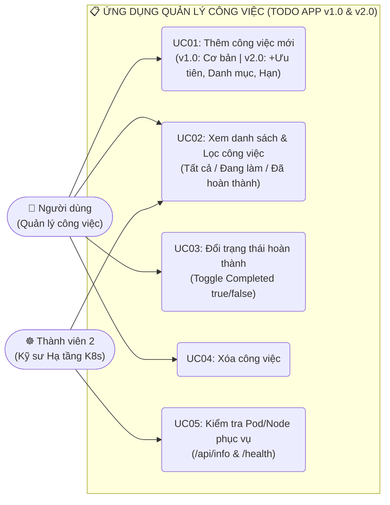
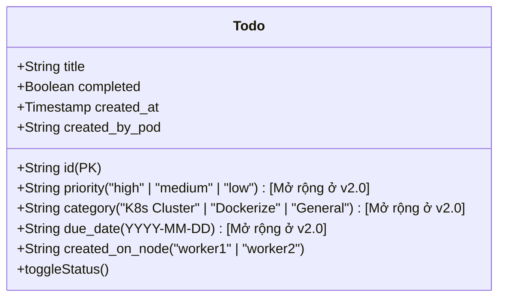
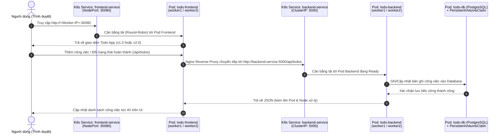

# 📋 TÀI LIỆU PHÂN TÍCH & THIẾT KẾ HỆ THỐNG: ỨNG DỤNG QUẢN LÝ CÔNG VIỆC (TODO APP `v1.0` & `v2.0`)
**Môn học**: Điện toán đám mây (Cloud Computing)  
**Đề tài nhóm**: Xây dựng Ứng dụng Quản lý Công việc (Todo App tối giản `v1.0` & `v2.0`) kết nối Cơ sở dữ liệu, Đóng gói Docker và Triển khai trên Cụm Kubernetes 3 Node (`cp`, `worker1`, `worker2`) có Kiểm thử Chịu lỗi (Fault Tolerance).

---

## 🔍 1. TỔNG HỢP NGUỒN TÀI LIỆU THAM KHẢO & DATASET (KAGGLE, GITHUB, STUDOCU)

Để phục vụ phần **Phân tích Thiết kế Hệ thống**, **Cơ sở dữ liệu** và **Triển khai Cloud / Kubernetes** cho đề tài **Ứng dụng Quản lý Công việc (Todo App / Task Management System)**, nhóm sử dụng và tham khảo từ các nguồn chuẩn sau:

1. **Trên Kaggle (Bộ dữ liệu mẫu cho Ứng dụng Quản lý Công việc / Task Management)**:
   - **Task Management & Productivity Dataset**: Chứa danh sách công việc (`task_id`, `title`, `status`/`completed`, `priority`, `category`, `due_date`, `created_at`).
     - *Từ khóa tìm trên Kaggle*: `Task Management Dataset` hoặc `Todo List Productivity Dataset`.
   - **Jira / Agile Project Tasks Dataset on Kaggle**: Bộ dữ liệu chuẩn về quản lý đầu việc kỹ thuật theo mức độ ưu tiên (`High`, `Medium`, `Low`) và trạng thái hoàn thành.
2. **Trên GitHub (Kiến trúc 3-Tier Todo App trên Docker & Kubernetes)**:
   - *Từ khóa tìm kiếm*: `todo-app-kubernetes-deployment` hoặc `fullstack-todo-docker-k8s`.
   - Cung cấp mô hình chuẩn tách biệt 3 tầng: **Frontend (Nginx + UI)** &rarr; **Backend REST API (Node.js/Express)** &rarr; **Database (PostgreSQL + PersistentVolumeClaim)**.
3. **Trên Studocu / Scribd (Tài liệu Phân tích Thiết kế Hệ thống Quản lý Công việc)**:
   - *Từ khóa tìm kiếm*: `"Phân tích thiết kế hệ thống quản lý công việc" Use Case ERD`.

---

## 👥 2. PHÂN TÍCH YÊU CẦU & BIỂU ĐỒ USE CASE CỦA TODO APP

### 2.1. Xác định Tác nhân (Actors) và Chức năng cốt lõi
1. **Người dùng (User / Thành viên nhóm)**:
   - **UC01 — Thêm công việc mới (`Add Todo`)**: Nhập tiêu đề công việc cần làm (ở bản `v1.0`) và bổ sung thêm *Mức độ ưu tiên (`priority`)*, *Danh mục (`category`)*, *Hạn hoàn thành (`dueDate`)* (ở bản `v2.0`).
   - **UC02 — Xem danh sách công việc (`View & Filter Todos`)**: Xem toàn bộ công việc từ Cơ sở dữ liệu, lọc theo trạng thái (`Tất cả`, `Chưa hoàn thành`, `Đã hoàn thành`) và tìm kiếm theo từ khóa.
   - **UC03 — Đổi trạng thái hoàn thành (`Toggle Complete Status`)**: Đánh dấu một công việc từ `Chưa hoàn thành (false)` sang `Đã hoàn thành (true)` hoặc ngược lại, lưu bền vững vào Database.
   - **UC04 — Xóa công việc (`Delete Todo`)**: Xóa công việc không còn cần thiết khỏi Database.
2. **Kỹ sư Hạ tầng Kubernetes — Thành viên 2 (K8s Infra Engineer)**:
   - **UC05 — Giám sát Cụm 3 Node (`cp`, `worker1`, `worker2`)**: Theo dõi Pod nào (`POD_NAME`) và Worker Node nào (`NODE_NAME`) đang xử lý request của Todo App.
   - **UC06 — Kiểm thử Cân bằng tải & Chịu lỗi (`Fault Tolerance Test`)**: Gửi chuỗi 10 requests liên tiếp để kiểm chứng cân bằng tải giữa `worker1` và `worker2`, cũng như kiểm chứng khả năng tự tái tạo Pod (Self-Healing) khi tắt nguồn `worker2` trên Cloud.

### 2.2. Biểu đồ Use Case Tổng quát (Use Case Diagram)

---

## 🗄️ 3. THIẾT KẾ CƠ SỞ DỮ LIỆU & PHIÊN BẢN HÓA (`v1.0` vs `v2.0`)

### 3.1. Sơ đồ Thực thể / Bảng Dữ liệu (`todos` Table trong PostgreSQL)

### 3.2. Thiết kế Phiên bản hóa (`v1.0` & `v2.0`) phục vụ Kịch bản Demo Rollout / Rollback

| Tiêu chí | Bản `v1.0` (Phiên bản Cơ bản) | Bản `v2.0` (Phiên bản Nâng cấp — Demo Rollout) |
|:---|:---|:---|
| **Docker Image Tags** | - `<user>/todo-frontend:v1.0` - `<user>/todo-backend:v1.0` - `<user>/todo-db:v1.0` | - `<user>/todo-frontend:v2.0` - `<user>/todo-backend:v2.0` *(Tuyệt đối không dùng tag `latest`)* |
| **Giao diện (UI Theme)** | Tone màu **Xanh Dương (Cloud Blue `#2563eb`)** tối giản, trực quan | Đổi sang tone màu **Tím Neon & Ngọc lục bảo (`#7c3aed` &rarr; `#059669`)** nổi bật kèm Banner thông báo `v2.0` |
| **Chức năng & Trường dữ liệu** | - Thêm công việc (`title`) - Xem danh sách công việc - Đổi trạng thái hoàn thành (`completed`) | Giữ nguyên dữ liệu cũ và **bổ sung thêm 3 trường dữ liệu mới**: 1. **Mức độ ưu tiên (`priority`)**: Cao / Trung bình / Thấp 2. **Phân loại hạng mục (`category`)** 3. **Hạn hoàn thành (`dueDate`)** |

---

## 🔄 4. BIỂU ĐỒ TRÌNH TỰ (SEQUENCE DIAGRAM) LUỒNG HOẠT ĐỘNG TRÊN CỤM KUBERNETES 3 NODE

